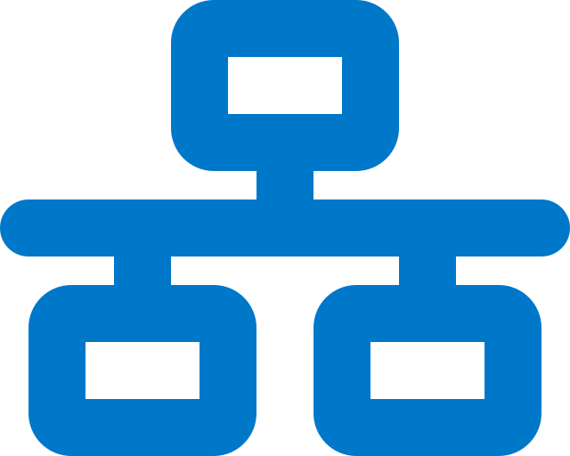

#  [Architecture](architecture.md)
What are the concepts?

#  [Installation](installation.md)
How is the project installed?

#  [User Guide](user_guide.md)
How to use the system and start a mobile network?

#  [Stacks](stacks.md)
Which components can be combined?

#  [Development](development.md)
How to extend the project?
